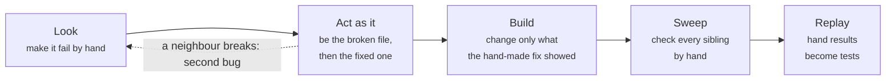
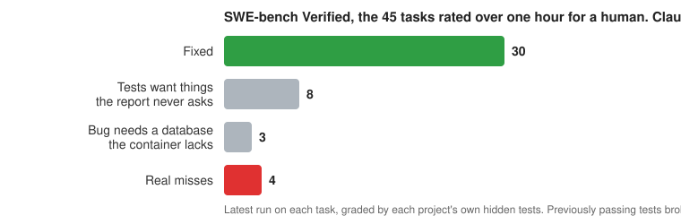

# rehearse

**A Claude Code plugin that makes the AI see a bug fail before it fixes it, then check every place the fix should reach.**

- [What it does](#what-it-does)
- [What it looks like](#what-it-looks-like)
- [The loop](#the-loop)
- [What the guard refuses](#what-the-guard-refuses)
- [Does it work?](#does-it-work)
- [Install](#install)
- [For developers](#for-developers)

## What it does

Most coding agents read the bug report, read some code, write a fix that looks right, and hand it back. Often it fixes the example in the report and leaves the same bug alive somewhere else. Sometimes it fixes the wrong bug.

`rehearse` changes the order. Before the agent may touch code, it has to make the bug happen by hand and write down what it saw. After the fix, it has to look for every other place the same cause lives and check each one. It cannot hand back work while its own tests are red.

These are not requests. A guard watches every command and refuses the shortcuts.

## What it looks like

The bundled demo is a five-file program that loses its March orders. The agent is told only "fix the missing March orders". Its log:

```
S1: main.py -> March 80.00
S2: parse_date("04/03/2024") -> None, so the row is dropped
S3: to_amount("12,50") -> ValueError.   Revealed by: S2 fix
Expected by hand: March = 162.50
```

Three real calls. The second finds the bug. The third finds a second bug that was hiding behind the first. The agent wrote the right answer down before changing any code, fixed both files, ran the program: 162.50.

You can read that log without reading code.

## The loop



The same loop builds new programs: the agent does the job by hand first, one request or one query at a time, and builds only from the steps that worked.

## What the guard refuses

- **Scripts.** During a rehearsal the agent may run what already exists. It may not write new code to run.
- **Editing before a real call.** No code changes until the guard's own log shows the agent ran something. Reading and note-taking do not count.
- **Finishing with red tests.** Sent back once: fix it or undo it.
- **Finishing without a sweep.** Sent back once: search for the siblings and check one by hand.

Every refusal names what to do instead. Everything the agent ran is kept in `.rehearsal/` for you to read.

## Does it work?

Measured on the hardest part of the standard bug-fixing benchmark and on a standard terminal-task benchmark, with Claude Sonnet 5.5. Every run is in [`bench/`](bench/) and can be repeated.

**SWE-bench Verified, the 45 tasks rated over one hour for a human.** Real bugs in Django, sympy, sphinx, astropy and others, graded by each project's own hidden tests.



**Terminal-Bench 2.1, seeded sample:** 5 of 5 passed so far. Typical run on either benchmark: about 15 minutes, 20 cents.

### Same bug, same model, before and after

Django 13344. Claude Sonnet both times.

<table>
<tr><th width="50%">Before reproduction was enforced</th><th width="50%">After</th></tr>
<tr><td valign="top">

Read four files, wrote "S1: read deprecation.py", edited.

Fixed a real bug, the wrong one. Its own test passed. The hidden tests failed.

Its report: "I made no hand-run call that executed code."

</td><td valign="top">

Built the real handler by hand and asked whether the chain is async: **False**. That is the bug.

Four small edits, same call again: **True**. 1,014 tests pass. Hidden tests pass.

</td></tr>
</table>

Every rule that was only words got ignored. Every rule that became a refusal changed behaviour the same day. The full story is in [`bench/README.md`](bench/README.md).

## Install

```
/plugin marketplace add woosikkim/rehearse
/plugin install rehearse@rehearse
```

Ask for a fix, or say **rehearse** in your prompt to force it. To see it on the demo:

```
cd demos/five-files
claude "rehearse: fix the missing March orders"
```

Then read `.rehearsal/REHEARSAL.md`.

## For developers

<details>
<summary>Hooks, other agents, tests, limits</summary>

### Hooks

All run [`hooks/guard.py`](hooks/guard.py), Python 3 standard library only. One helper agent ships with it, [`agents/rehearser.md`](agents/rehearser.md), which can look but not write.

| Hook | What it does |
|---|---|
| `SessionStart` | Adds one standing sentence: before building or fixing anything that depends on something outside the code, load the rehearse skill. |
| `UserPromptSubmit` | A prompt containing the word `rehearse` always loads the skill. |
| `PreToolUse` | Loading the skill creates `.rehearsal/fixtures/`, `.rehearsal/scaffold/` and the marker `.rehearsal/active`. While the marker exists: anything that existed before it may run; anything written since may not. One-line calls to existing code (`python3 -c '…'`, `node -e`, `ruby -e`, single quotes, up to twelve straight-line statements, no logic or file access) are allowed. Loops, background jobs, new scripts, shell writes to code files, in-place editors and command substitution inside double quotes are refused with a message naming the alternative. Files under `.rehearsal/scaffold/` may be created but never run or imported. Once the marker is gone, code edits stay refused until `.rehearsal/log.md`, written only by the guard, holds one command that ran something. |
| `PostToolUse` / `PostToolUseFailure` | While the marker exists, every shell command and the first lines of its output go to `.rehearsal/log.md`, with common secrets redacted. Once building has begun, every command goes to `.rehearsal/build.log`, with each code edit noted. Test runs also go to `.rehearsal/tests.log`. |
| `Stop` | While `.rehearsal/` exists, the agent is refused once when it tries to finish if the last logged test run is red (a stashed baseline run is not counted), or if code was edited and no sweep followed: a codebase search plus a new by-hand call after the first edit. The second attempt always goes through. |

### Other agents

Codex, Gemini CLI, Cursor, Copilot and others that support the [Agent Skills](https://agentskills.io) standard: copy `skills/rehearse/` into your agent's skills folder. The skill works as-is; there is no guard unless you wire one up. `hooks/guard.py` reads a pre-tool-use payload as JSON on stdin and exits `2` to block, and recognises `shell`/`exec_command`/`run_shell_command` and `write_file`/`replace`/`apply_patch` tool names. Untested outside Claude Code.

### Tests

```
python3 tests/test_guard.py
```

### Limits

- The guard is a speed bump, not a sandbox. An agent can `rm .rehearsal/active` early, but cannot edit code until its log shows one real call; the only other exit is deleting `.rehearsal/` entirely, which leaves no log at all. A meaningless call satisfies the gate; it also sits in the log for the reader to see.
- Known ways around the guard, listed rather than patched until a git-tracked "existing" check lands: backdating a file with `touch -d`; logic hidden in `awk` or `jq` programs; editing an extension-less file such as a `Makefile` and running `make`; `io.FileIO("a.py", "w")`; standard-library runners that execute code handed to them (`python3 -m timeit -s …`, `python3 -m pdb notes.txt`); wrappers the guard does not know (`nice -n 5 python3 new.py`, `env -S …`, `stdbuf`, `setsid`, `pypy3`); `find . -exec python3 x.txt \;`; `ruby -e 'load "x.txt"'`; `node -e 'import("./x.js")'`; attribute lookups that spell a blocked name in pieces; creating the marker without `touch`. A bypass that shows up unprompted in a real rehearsal log is patched.
- Known false blocks, each with a message naming the accepted alternative: unquoted heredocs with shell-like prose; double-quoted one-liners; an interpreter flag before a file; `php -r`; data strings containing an access word as a whole word; single-quoted text containing `"$(`; `sort -u` arguments over-redacted in the logged command.
- The Stop rule reads test output as text (pytest, unittest, Django, jest, go, cargo and similar). A runner it does not recognise passes through. It cannot tell which tests were green before the change, only whether the last run is red. An agent can edit existing tests until they pass; the log shows it, the guard does not stop it.
- The sweep rule makes the agent look for siblings; it cannot make it recognise one.
- Bugs that need something the machine does not have (a particular database, a live service) cannot be rehearsed. The honest outcome is "not reproduced, not fixed", which the skill asks for and the agent does not always choose.
- The auto-log redacts common secret patterns but is not a secrets filter.
- Anything that fails only over time is reported as an unverified risk, not tested.

</details>

## License

MIT
