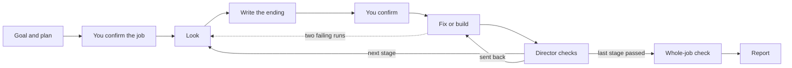

# rehearse

**A Claude Code plugin that makes the AI look at the real thing before it changes code, and won't let it call the work done until an independent check passes.**

[](https://github.com/woosikkim/rehearse/actions/workflows/tests.yml) [](https://github.com/woosikkim/rehearse/releases) [](LICENSE)

## Why

Use it to fix a program that errors or gives a wrong result, to build a small program that talks to the outside world, such as a scraper, an API client, an automation or a file converter, or to run a longer job in steps, such as "collect the data, process it, write a draft, stop before upload".

Coding agents guess. They read some code, edit it, rerun the program and edit again, instead of looking at the thing that holds the answer: the server's real response, or the actual data one file hands to the next. One direct look usually finds the cause at once.

rehearse makes that direct look the rule. The AI does the job by hand first, agrees with you on what the right result is, and only then changes code. A second AI that did not do the work checks it before it may finish.

The work is split between three AIs, and you only ever talk to the first:

- **The manager** is your own Claude Code session. It asks what you want, writes the plan, asks you to confirm, starts the others one at a time and writes the report.
- **A worker** does one stage. One worker looks at the real thing and writes down what the right result is; a fresh worker then builds until that result shows.
- **The director** judges each stage and the whole job. It did not do the work and cannot edit files.

A small job has one stage, and the manager does it itself without a worker. The director still checks it.

In an interactive session, Claude Code runs the worker and the director in the background. After starting one, the manager ends its turn and says it will continue when the agent finishes. The agent's result wakes the manager by itself, so there is nothing to type; in headless runs the agents run in the foreground.

## Quick start

Install it in Claude Code:

```
/plugin marketplace add woosikkim/rehearse
/plugin install rehearse@rehearse
```

Claude Code does not update plugins from third-party marketplaces on its own by default. To get a new version, run `claude plugin update rehearse@rehearse` in your shell, or turn on **Enable auto-update** for this marketplace under `/plugin` → **Marketplaces**. A session that is already running keeps the version it loaded until you restart it or run `/reload-plugins`.

Start a prompt with the word `rehearse` and say what you want:

```
rehearse the March total in the monthly report is wrong
rehearse a script that saves every product name and price from https://example.com/shop to products.csv
```

You'll see `rehearse is on — type rehearse stop to stop`. You can end the job at any time by typing `rehearse stop`, or by choosing **stop here and write the report** when you are asked a question.

If your request already lists steps, those steps become the stages. If it names a tool or library you want used, the worker tries that first.

Demo projects are in [`demos/`](demos/), each with its own README.

**Needs:** Claude Code, Python 3 and `curl`.

## How it works



1. **Goal.** The manager needs four things: what the job is for, what you get at the end, what counts as done, and what is out of scope. It asks once, in one set of up to four questions, for whatever your request did not say. Anything it did not ask is written down as an assumption.
2. **Plan.** The manager takes a quick look at the riskiest parts, such as a login, a paid service or the upload page at the end. Then it splits the job into stages. A stage ends only where the result must be checked before the next step can rely on it, or before a step that cannot be undone.
3. **You confirm the job.** For two or more stages you see the goal, the assumptions, anything blocking, the stages, the models and the whole-job check, in one question. A one-stage job skips this; its single confirmation also shows the goal and assumptions.
4. **Look.** For each stage, a worker does the job by hand against the real thing. It runs your program, calls your functions one step at a time in a *stage session* (a Python session where the plugin logs every step), and gets real server responses with the plugin's `fetch` command. Edits are locked while it looks.
5. **Write the ending.** The *ending* is the command to run and the result it must show. Every expected value has to come from something the worker saw or from your own words. The ending must fail right now, either because it shows the bug or because the program does not exist yet.
6. **You confirm.** You get one plain sentence with the command and values underneath. Your yes unlocks the edits for that stage.
7. **Fix or build.** A fresh worker changes the code and reruns the ending until it passes.
8. **The director checks.** It reruns the ending and tries inputs the worker did not use. It compares the tests with how they stood before the change, and looks for shortcuts such as edited or skipped tests. Then it passes the stage or sends it back. A passed stage hands its checked output to the next one.
9. **Whole-job check.** After the last stage, the whole-job check runs, and the director also reruns every stage's ending.
10. **Report.** The first line is `fixed` (every expected value verified), `built, not verified against the real target`, or `not fixed`. Below it is one row per stage with its ending in a plain sentence, what changed, what was simulated or stopped before, and what could not be verified.

**When work goes in circles.** Two failing runs in a row lock edits again, and the stage goes back to looking. One new look reopens it. Ten code edits with no run at all bring a reminder, not a lock. Each relock and each send-back is a *strike*; after three, the stage is stuck.

**When a stage is stuck.** The manager asks you once: **stop here**, **try again**, or **change the stage**, and says what each one does and costs. It records your answer with a command of its own, never by reading your words, and a change is confirmed with you a second time, since it redoes the stage from the look. It also asks this when a worker hits something it cannot get past, such as a login it was not given. A blocked step is never faked.

**Steps that cannot be undone.** Publishing, uploading, sending or deleting never runs without your explicit OK. The manager simulates it, or leaves it for you.

The plugin enforces two locks. There are no edits before you confirm the ending, and no finishing before the director passes the work or the manager writes an honest `not fixed` report. Files a stage is meant to produce, such as a CSV or a draft, are locked like code. While it is looking, a worker also cannot run a file it has just written; it uses the plugin's own tools instead. Everything else is a reminder.

## Settings

| Setting | Default | What it does |
|---|---|---|
| `confirm_ending` | `true` | Ask you about the goal, the plan and each ending. Turn it off for unattended jobs: nothing is asked, missing goal items are assumed, each ending is accepted when written down and marked "not confirmed by a person", and the report states each ending in plain words. A stuck stage then ends the job with a `not fixed` report. |
| `max_strikes` | `3` | How many relocks and send-backs a stage may take before it is stuck. |
| `loop_breaker_rounds` | `2` | Failing runs in a row before edits lock again. |
| `worker_model` | `sonnet` | The model the workers run on. |
| `director_model` | `opus` | The model the director runs on. Keep the default unless you accept a lighter judge; it is the correctness gate. |

Change them in your Claude Code settings file, for example:

```json
"pluginConfigs": {
  "rehearse@rehearse": { "options": { "confirm_ending": false } }
}
```

Each one can also be set with an environment variable: `REHEARSE_CONFIRM_ENDING`, `REHEARSE_MAX_STRIKES`, `REHEARSE_LOOP_BREAKER_ROUNDS`, `REHEARSE_WORKER_MODEL`, `REHEARSE_DIRECTOR_MODEL`. In plugin evals, the same names with an `EVAL_` prefix work too.

The Claude Code setting `CLAUDE_CODE_DISABLE_BACKGROUND_TASKS=1` forces every subagent into the foreground for the whole session, with side effects such as turning off background tasks and Ctrl+B; rehearse does not need it.

## Limits

- **Claude Code only.** claude.ai and Cowork do not install plugins that ship a `bin/` folder.
- **The stage session is Python only.** In other languages the worker looks through `fetch`, your existing programs and your tests. For a stage with no code, such as a draft, it looks at the file with `fetch`.
- **The stage session replays.** Each new step reruns the earlier ones in a fresh process, so a step that sends or changes data on a server would repeat. The worker is told to make such requests once with `fetch`, and the stage session warns when a step opens a network connection.
- **Some things cannot be verified in one run.** This covers anything that needs time, credentials you have not given, or an irreversible action. The report lists these as not verified.
- **A job costs more than a plain request.** Workers and the director are extra AIs. The director runs on the strong model (Opus) by default, because it is the correctness gate; a real two-stage job cost about $5 with the manager and the director on Opus and the workers on Sonnet. `director_model` is an optional setting if you accept a lighter judge; choosing a model per stage is left for a later version, once there is usage to go on.
- **A late problem cannot undo a passed stage.** If a later stage finds a blocker that makes an earlier, passed stage wrong, the only way out is to stop. The report names the stage that found it.
- **It never changes your files on its own.** If code changed while edits were locked, it names the files and asks for them to be put back.
- **No report means not fixed.** A job can end without a report: when you press Esc, when Claude Code hits a login or usage error, or when Claude Code stops holding the agent back. Treat any job without a report as not fixed.
- **Works alongside other tools.** rehearse needs no other plugin. It runs next to orchestration plugins such as oh-my-claudecode.

<details>
<summary><b>Design notes: how this came to be</b></summary>

### The problem

I kept watching coding agents work on programs that talk to a server. They would change the code, rerun it and change it again. When an agent finally looked at the server's actual response, the fix took one step. I wanted that direct look to be the rule, not luck.

The second idea came from the same place. A program is often a chain of files. The agent can stand in for the failing file: take its real input, do its job by hand, hand the result to the next file, and see where the chain really breaks.

### Version 0.7: rules that checked activity

The first versions grew one rule at a time. Whenever an agent found a shortcut, I added a wall that refused it. I ran 132 practice runs on public coding-benchmark tasks, and over those runs the guard refused 451 of 3,361 tool calls:

- 281 refusals were about how a command was written.
- 157 were about the guard's own marker file.
- 13 came from the edit gate, the rule that actually mattered.

The two walls that stopped the agent from finishing fired 23 times. The code changed afterwards only twice. A trivial command such as `python3 --version` counted as running the program. Every blocked shortcut produced a new one, and the guard grew to almost 900 lines.

Three lessons:

- A rule that checks activity is satisfied by the least activity. A rule that checks the outcome can only be satisfied by doing the work.
- A rule that exists only in words gets ignored. If the right path is not the easiest one, agents route around it.
- "Not fixed, here is what we learned" is an acceptable outcome. "Fixed" when it is not is the worst one.

### Version 2: check outcomes

- **Two locks instead of many walls.** No edits until an ending is confirmed, and no finishing until an independent director passes the work.
- **The ending must fail first.** An ending that already passes proves nothing.
- **Make the right path the easiest.** The stage keeps the direct look cheap, so the agent no longer retypes its setup into one-off scripts. `fetch` saves real responses as evidence.
- **Defend against the easy path, not against forgery.** Agents take the shortest route that seems to satisfy a rule, but they do not forge records; none of the practice runs tried to. So there are no hashes or tokens, only checks on what agents actually do.
- **A complexity rule.** A mechanism goes in only if it serves a stated requirement or blocks an observed shortcut. Everything else waits on a list, along with the evidence that would bring it in.

### Version 3: roles and stages

Version 2 handled one program at a time, with one AI doing everything. Version 3 adds larger jobs split into stages, where each stage's checked output feeds the next, and splits the work into roles: a manager that talks to you, workers that look and build, and the director that judges. No one judges their own work.

Several version 2 mechanisms only stood in for a missing manager, so they are gone:

- **The director's review of the ending in unattended runs.** Unattended endings are now accepted when written down, marked as not confirmed by a person, and stated in plain words in the report.
- **The guess at whether the agent looked.** The loop breaker now counts failing runs and logged look steps, the same way for every kind of ending.
- **The `fix` and `build` mode words.** The manager decides each stage's kind.
- **Voiding a pass, and the hook's own refusal of director edits.** The director simply has no editing tools.

### Trade-offs

- **A stage that replays steps instead of keeping a live process.** A live process needs sockets and background processes, which sandboxed shells refuse. A second transport would mean two behaviours to test. Replay is one mechanism. Its cost, repeated side effects, is handled with `fetch` and a network warning. A live process comes back if a real run shows harm.
- **State outside the project, with a copy inside.** Agents delete `.rehearsal/` as cleanup, so the real state lives in the plugin's data folder. The copy in the project is for the sandboxed command, and deleting it changes no decision.
- **Direct reruns count as failed rounds.** The plugin cannot judge an arbitrary command's output, so only its own run can count as a pass. That makes the plugin's run the easiest way out of a lock.

### How it is tested, and what that shows

- Deterministic tests of every rule, with no AI involved (`tests/`).
- Eval cases on small demo projects, three runs each, with and without the plugin (`evals/`), including one multi-stage job. The first five all pass at 2.0.0.
- Demos run by hand outside the eval sandbox, including the mock server whose documentation is wrong. In that run the director rejected the agent's first ending. That ending only checked the exit code, so a hard-coded script would have passed it.

This shows that the plugin behaves as designed on small cases. It is not a performance claim. The practice runs are kept on the [`practice-runs`](https://github.com/woosikkim/rehearse/tree/practice-runs) branch: 176 in all, with plugin versions and models mixed, of which the 132 above are the ones counted. They were used to find failure modes, and the guard was tuned on those same tasks. A proper measurement on tasks never used in development is planned.

### How it was built

I set the goals, made the design decisions and reviewed each revision. Claude Code, with oh-my-claudecode, wrote the code. The design went through ten plan revisions, with outside reviews, before any code was written. The design briefs are in [`docs/rehearse-v2-brief.md`](docs/rehearse-v2-brief.md) and [`docs/rehearse-v3-brief.md`](docs/rehearse-v3-brief.md).

</details>

<details>
<summary><b>For developers</b></summary>

### Hooks

All of them run [`hooks/rehearse_hook.py`](hooks/rehearse_hook.py), which uses the Python 3 standard library only. The job file lives outside the project, in the plugin's data folder. Each save also writes a copy to `.rehearsal/<job id>/state.json` for the plugin's own command. The readable evidence (log, fixtures, report) lives in `.rehearsal/<job id>/`, one folder per job, with steps numbered across all stages.

| Hook | What it does |
|---|---|
| `UserPromptSubmit` | Starts a job on `/rehearse` or a prompt that starts with the word `rehearse`, and injects the manager instructions. `rehearse stop` cancels the job. While a job waits for the user, the next prompt is the answer. |
| `PreToolUse` | While the current stage is looking or waiting for confirmation, refuses Write, Edit, MultiEdit and NotebookEdit on project code and declared outputs, and shell commands that write them. Refuses running a file created during the stage. Refuses every write to the run folder's own records (`results.jsonl`, `state.json`, `commands.jsonl`, `log.md`) in every phase. On a `rehearse:worker` or `rehearse:director` spawn, writes its prompt from the job file, sets its model and keeps it in the foreground; refuses a worker outside look and build, and the director outside build and judge. |
| `PostToolUse` | Logs every command and its output to `log.md` and `commands.jsonl`. Reads each `rehearse` command's result from the record the command itself writes in the run folder (`results.jsonl`), so a filter on its output loses nothing. Counts failing runs and look steps, locks edits again after two failing runs, and reminds after ten code edits with no run. Records the answers to the goal and confirmation questions; the stuck answer is recorded by `rehearse stuck`. Adds a note with the next step when a worker or the director returns. |
| `PostToolUseFailure` | Handles failed shell commands and agent calls the same way. |
| `SubagentStop` | Records the director's verdict and moves the job to the next stage on a pass. A verdict is void if code or a declared output changed while the director worked. Records how a worker's turn ended, and counts a strike when a build worker stops with neither a passing run nor a relock, or a look worker returns no ending twice in a row. |
| `Stop` | Refuses to finish until the next step is done, except while waiting for the user: write the plan, register an ending, start a worker or the director, or write `report.md` with an allowed first line and a not-verified section. |

### Plugin commands

These are on the agent's path while the plugin is enabled ([`bin/rehearse`](bin/rehearse)):

```
rehearse plan --goal <item> request|answer|assumed '<text>' ... --stage-def <name> fix|build '<plan line>' <inputs> <outputs> ...
rehearse ending [--job] --cmd '<cmd>' [--tests '<cmd>'] --expect '<requirement>' <check> <value> --cite <source> ... [--unchecked '<item>']
rehearse run [--as-director] [--stage <n>]
rehearse fetch <url> [curl args]
rehearse job          (also: rehearse status)
rehearse stuck --stop-here | --try-again | --change --confirmed
rehearse stage start [--python <path>] | step '<code>' | stop
```

### Tests

```
python3 tests/run_all.py
claude plugin eval . --scaffold --allow-tools Bash Write Edit Agent --trust-plugin --runs 3
```

The first command runs the deterministic hook, job, stage and director tests, and prints nothing on success. The second runs the cases in `evals/`, with and without the plugin.

### More limits

- Inside other interpreters (node, ruby and so on), nothing checks what a one-line program does; only the files it writes are seen afterwards.
- Files written outside the project are recorded, not refused.
- A direct run is recognised only when the program is named by its path or is a known test runner. `./prog` from another folder, `python3 -m pkg` and wrapper scripts get the reminder, not the lock.
- Text a hook adds never reaches a plugin eval's trace, so graders can only read what the agent itself printed.
- On a one-stage job the manager looks itself, with no worker; if it cannot write an ending, the only way on is through you.
- Shell commands that edit a copy in place outside the project are not counted toward the ten-edit reminder.
- A stage ending may also be registered while the stage waits for confirmation.
- Declared outputs are locked against edit tools and parsed shell writes only. A program that writes the file itself, a check script that reads an undeclared file, and scratch scripts outside the project are not refused; the fail-first rule and the director are the checks then.
- A loop inside one command runs to the end before any check sees it.
- Claude Code stops honouring a Stop hook after eight blocks in a row with no tool call in between (Claude Code 2.1.300, probe P7). An agent that only keeps trying to finish can therefore end without a report. Interrupts and authentication errors skip the Stop hook by design.
- If you edit project code yourself while edits are locked, the ending cannot be registered until those files are restored.
- Taking a fingerprint of the project is slow on Windows folders mounted under WSL, about 1 to 2 seconds per check.

</details>

## License

MIT
