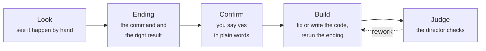

# rehearse

**A Claude Code plugin that makes the AI see a bug happen, and agree with you on the right answer, before it changes any code.**

- [How it works](#how-it-works)
- [What it does](#what-it-does)
- [What it looks like](#what-it-looks-like)
- [The loop](#the-loop)
- [What the guard refuses](#what-the-guard-refuses)
- [Does it work?](#does-it-work)
- [Install](#install)
- [For developers](#for-developers)

## How it works

**The AI becomes the broken file.** A program is usually a chain of files handing work to each other, like people on a production line. When one of them is broken, `rehearse` makes the AI stand in that person's spot and do the job by hand before it changes anything.

Say five files turn a spreadsheet of orders into a monthly report, and the March total is wrong. The AI takes the place of file 3: it feeds in the real March rows one at a time and sees which one gets dropped, and why (the date is written `04/03/2024`). Then it acts as the *fixed* file 3: it hands the corrected rows to file 4 by hand, and sees file 4 choke on a price written `12,50`. Two bugs found, the second one hidden behind the first, and not a line of code written yet. It works out the right total by hand, 162.50, and asks you: "When I run the report, March should show 162.50; right now it shows 80.00. Right?" Only after you say yes may it fix anything. When it is done, a second AI, the director, checks the work without trusting the first one's story.

## What it does

Most coding agents read the bug report, read some code, write a fix that looks right, and hand it back. Often that fixes the example in the report and leaves the same bug alive somewhere else. Sometimes it fixes the wrong bug.

`rehearse` turns on when you start a prompt with **rehearse** (or type `/rehearse`). From then on:

- the AI looks at the real thing by hand, one step at a time, and every step is logged by the plugin, not typed by the AI;
- it writes down the **ending**: the command to run and the result it must show, each value traced to a step it saw or to your own words;
- you confirm the ending in plain words before any code changes;
- an independent director reruns the ending, tries inputs the AI did not, and checks that tests which passed before still pass;
- the report's first line tells you honestly: `fixed`, `built, not verified against the real target`, or `not fixed`.

Type `rehearse stop` at any time to end it.

## What it looks like

The bundled demo is a five-file program that loses its March orders. The agent is told only "fix the missing March orders". What its run folder shows, shortened:

```
S1  python3 main.py                         -> 2024-03  80.00
S3  parse_date("04/03/2024")                -> None, so the row is dropped
S5  to_amount("12,50")                      -> ValueError    Revealed by: S3, the date fix
S6  March by hand                           -> 162.50

Asked: "When I run the report, March should show 162.50; right now it shows 80.00."   You: yes

Ending: python3 main.py
| Expected               | Before | After  |      |
|------------------------|--------|--------|------|
| March shows 162.50     | 80.00  | 162.50 | PASS |

Director: PASS, after trying date and price shapes the agent did not use.
```

You can read that without reading code.

## The loop



The same loop builds new programs: the AI does the job by hand first, one request at a time, against the real website or API, and builds only from what it saw.

## What the guard refuses

Only two things, and both say what to do instead:

- **Changing code before the ending is confirmed.** Until you have said yes to the ending, every edit to the project's code is refused, whichever way the AI tries to write it.
- **Finishing before the director passes.** The AI cannot hand back the work until the director has checked it, or until it writes an honest `not fixed` report.

One more rule keeps the looking honest: while it is looking, the AI cannot run a file it has just written itself. It looks with the plugin's own tools instead, which log every step.

## Does it work?

Measured on the hardest part of the standard bug-fixing benchmark and on a standard terminal-task benchmark, with Claude Sonnet 5.5. Every run is in [`bench/`](bench/) and can be repeated.

**SWE-bench Verified, the 45 tasks rated over one hour for a human.** Real bugs in Django, sympy, sphinx, astropy and others, graded by each project's own hidden tests.


**Terminal-Bench 2.1, seeded sample:** 5 of 5 passed so far. Typical run on either benchmark: about 15 minutes, 20 cents.

### Same bug, same model, before and after

Django 13344. Claude Sonnet both times.

<table>
<tr><th width="50%">Before reproduction was enforced</th><th width="50%">After</th></tr>
<tr><td valign="top">

Read four files, wrote "S1: read deprecation.py", edited.

Fixed a real bug, the wrong one. Its own test passed. The hidden tests failed.

Its report: "I made no hand-run call that executed code."

</td><td valign="top">

Built the real handler by hand and asked whether the chain is async: **False**. That is the bug.

Four small edits, same call again: **True**. 1,014 tests pass. Hidden tests pass.

</td></tr>
</table>

Every rule that was only words got ignored. Every rule that became a refusal changed behaviour the same day. The full story is in [`bench/README.md`](bench/README.md).

These results are from version 0.7. Version 2 is being measured with the plugin's own evals in [`evals/`](evals/).

## Install

```
/plugin marketplace add woosikkim/rehearse
/plugin install rehearse@rehearse
```

Start a prompt with **rehearse** to turn it on. To see it on the demo:

```
cd demos/five-files
claude "rehearse: fix the missing March orders"
```

Then read the report in `.rehearsal/`.

## For developers

<details>
<summary>Hooks, commands, settings, tests, limits</summary>

### Hooks

All run [`hooks/rehearse_hook.py`](hooks/rehearse_hook.py), Python 3 standard library only. State lives outside the project, under the plugin's data folder; the readable evidence lives in `.rehearsal/<run id>/` in the project.

| Hook | What it does |
|---|---|
| `UserPromptSubmit` | Starts a run on `/rehearse` or a prompt that starts with the word `rehearse`, and injects the fix or build instructions. `rehearse stop` cancels the run. While the ending waits for confirmation, the next prompt is the answer. |
| `PreToolUse` | While the ending is not yet confirmed: refuses Write, Edit, MultiEdit and NotebookEdit on project code, and shell commands that write a code file. Refuses running a file created during the run. On a `rehearse:director` spawn, sets its prompt and model. Refuses edits by the director. |
| `PostToolUse` | Logs every command and its output to `log.md` and `commands.jsonl`. Reads the result line of each `rehearse` command into the state. Counts edit rounds and direct looks, and locks edits again after two failing rounds with no direct look. Records the answer to the confirmation question. |
| `SubagentStop` | Records the director's verdict, or its review of the ending in an unattended run. A verdict is void if code changed while the director worked. |
| `Stop` | Refuses to finish until the next step is done: register an ending, confirm it, spawn the director, write `report.md` with an allowed first line. |

### Plugin commands

On the agent's path while the plugin is enabled ([`bin/rehearse`](bin/rehearse)):

```
rehearse ending --cmd '<cmd>' [--tests '<cmd>'] --expect '<requirement>' <check> <value> --cite <source> ...
rehearse run
rehearse fetch <url>
rehearse status
rehearse stage start [--python <path>] | step '<code>' | stop
```

### Settings

| Setting | Default | Environment override | What it does |
|---|---|---|---|
| `confirm_ending` | true | `REHEARSE_CONFIRM_ENDING` | Ask the user to confirm the ending. Off for unattended runs: the director reviews it instead. |
| `max_rejections` | 3 | `REHEARSE_MAX_REJECTIONS` | Director rejections before the run ends with a `not fixed` report. |
| `loop_breaker_rounds` | 2 | `REHEARSE_LOOP_BREAKER_ROUNDS` | Failing edit rounds with no direct look before edits lock again. |
| `director_model` | opus | `REHEARSE_DIRECTOR_MODEL` | The model the director runs on. |

### Tests

```
python3 tests/run_all.py
claude plugin eval . --scaffold --allow-tools Bash Write Edit Agent --trust-plugin --runs 3
```

The first runs the deterministic hook, stage and director tests and prints nothing on success. The second runs the six cases in `evals/`, with and without the plugin.

### Limits

- The stage, where the AI calls project code by hand, is Python only. Other languages look through `rehearse fetch`, existing programs and tests.
- Inside other interpreters (node, ruby and so on) nothing checks what a one-line program does; only the files it writes are seen afterwards.
- Files written outside the project are recorded, not refused.
- The plugin never modifies your files. If code changed while edits were locked, it names the files and asks for them to be put back.
- Plugins with a `bin/` folder are not installed by claude.ai or Cowork, so this works in Claude Code only.
- A loop inside one command runs to the end before any check sees it.
- If you edit project code yourself while edits are locked, the ending cannot be registered until those files are restored.
- Taking a fingerprint of the project is slow on Windows-mounted folders under WSL (about 1 to 2 seconds per check).
- Anything that fails only over time is reported as not verified, not tested.

</details>

## License

MIT
