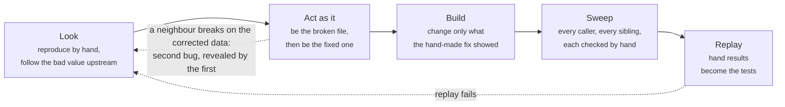

# rehearse

**A Claude Code plugin that makes the AI see a bug fail before it fixes it, and check every place the fix should reach.**

Most coding agents work like this: read the bug report, read some code, write a fix that looks right, run the tests, hand it back. It is fast, and it is how you get a fix that passes the one test in the report and leaves the same bug alive in two other places. Or a "fix" for the wrong bug entirely.

`rehearse` changes what the agent is allowed to do and when. Before it may touch a line of code, it has to reproduce the problem **by hand**, one real command at a time, and write down what it saw. After it has fixed the cause, it has to go looking for every other place that same cause shows up, and check each one the same way. And it cannot hand the work back while its own tests are red.

None of that is a request. It is enforced by a guard that watches every command the agent runs and refuses the shortcuts.

## What it looks like

Here is the agent's log from the bundled demo, a five-file program that loses its March orders. The agent is told only "fix the missing March orders".

```
### S1: main.py -> March 80.00                              (saved as fixtures/before.txt)
### S2: parse_date("04/03/2024") -> None, so the row is dropped
### S3: to_amount("12,50") -> ValueError.  Revealed by: S2 fix (rows now reach price.py)
## Expected by hand: 12.50 + 40.00 + 30.00 = 82.50; March = 162.50
## What I'd change: parse_date accepts day/month/year; to_amount accepts a comma
```

Three real calls, each one a line. The second call finds the bug. The third finds a second bug that was hidden *behind* the first: once March rows get through, the price parser chokes on a European decimal comma. The agent found it by acting as the fixed file and feeding its output to the next file by hand, not by reading. Then it wrote the expected total down before writing any code, fixed both files, and ran the program: March 162.50.

That log is the product. You can read it without reading code and know exactly what was checked.

## The loop



- **Look.** Reproduce the problem once, by hand. Find the place where good input turns into bad output. If the bad value arrives from somewhere else, follow it upstream until you find where it is first made wrong. That is where the fix belongs.
- **Act as it.** Be the broken file: call it with the real input and watch it fail. Then be the fixed file: write down, by hand, what it *should* produce, and feed that to its neighbours one call at a time. Anything that breaks on the corrected data is a second bug, logged as "revealed by" the first.
- **Build.** Only now change code, and only what the hand-made fix showed.
- **Sweep.** Find every caller of what you changed and every other place that does the same job. Call each one by hand with the bad input. Fix what fails.
- **Replay.** Everything you saw by hand becomes a test. Run the real program on the same sample and compare.

The same loop works for building something new: the agent does the program's job itself first, one `curl` or one query at a time, and only builds from the steps that actually worked.

## What the guard refuses

The skill tells the agent what to do. The guard is what makes it true. While a rehearsal is on:

- **No scripts.** The agent may run anything that existed before the rehearsal started, and may not write new code to run. It can type one-line calls to existing functions, which is how it reproduces things by hand. A specimen that a real tool needs to read, such as a tiny docs project, goes in one folder the agent can fill but never execute.
- **No edits before a real call.** Code edits stay refused until the guard's own log shows the agent actually ran something. Reading files does not count. Notes do not count. The log cannot be written by hand.
- **No finishing with red tests.** If the agent's last test run shows failures, it is sent back once: fix the cause or undo the change.
- **No narrow fix.** If code was edited and nothing after the first edit was a search of the codebase plus a fresh by-hand check, it is sent back once: look for the siblings.

Every refusal says what the agent may do instead. Every command and its result is recorded in `.rehearsal/`, so there is always an audit trail, and the agent is told to leave it in place for you.

## Does it work?

We measured it on the hardest part of the standard bug-fixing benchmark, and on a standard terminal-task benchmark. All runs use Claude Sonnet 5.5 and are reproducible from the files in [`bench/`](bench/).

**SWE-bench Verified, the 45 tasks rated as taking a human over an hour.** Real bugs from Django, sympy, sphinx, astropy, scikit-learn, pytest, pylint and xarray, graded by the projects' own hidden tests.


Typical run: 15 minutes, 21 cents.

Of the 15 misses, 8 are tasks whose hidden tests demand things the bug report never asks for, 3 are bugs that only appear on a database the test container does not have, and 4 are real misses. The plugin was improved *using* these runs, so the versions are not uniform; the full story, version by version and failure by failure, is in [`bench/README.md`](bench/README.md).

**Terminal-Bench 2.1, a seeded sample.** Tasks like "find and fix the security weakness in this web framework", "repair this corrupted database", "finish this formal proof".

| | |
|---|---|
| Passed | 5 of 5 so far |
| Typical run | 12 minutes, 20 cents |

### Same bug, same model, before and after

Django bug 13344, an async middleware receiving a coroutine instead of a response. Claude Sonnet both times.

<table>
<tr><th width="50%">Before the guard enforced reproduction</th><th width="50%">After</th></tr>
<tr><td valign="top">

Read four files. Wrote two notes: *"S1: read deprecation.py"*, *"S2: spot stale state in load_middleware"*. Took the marker down. Edited the handler.

Fixed a real bug, the wrong one: a neighbouring flaw in how an unused middleware is skipped. Wrote its own test, which passed. The hidden tests failed.

Its report: *"I made no hand-run call that executed code."*

</td><td valign="top">

Built the real ASGI handler by hand and asked whether the middleware chain is a coroutine function: **False**. That is the bug, seen running. One more call isolated the four classes that skip the async check.

Marker down, four small edits, same call again: **True**. Then 1,014 tests, all passing. Hidden tests: all passing.

Its report separates *"verified for real"* from *"not done"*.

</td></tr>
</table>

What we learned the hard way, and what the plugin does about it, is the interesting part. Short version: every rule that was only words got ignored; every rule that became a refusal changed behaviour the same day.

## Install

In Claude Code:

```
/plugin marketplace add woosikkim/rehearse
/plugin install rehearse@rehearse
```

Then just ask for a fix, or say the word **rehearse** in your prompt to force it. The agent announces how it sized the job in its first line and gets on with it.

## Try the demo

```
cd demos/five-files
claude "rehearse: fix the missing March orders"
```

Then read `.rehearsal/REHEARSAL.md`. There is a second demo, `demos/new-program`, where the agent builds a small scraper against a local site the same way.

<details>
<summary><strong>For developers: hooks, other agents, limits</strong></summary>

### The hooks

All of them run [`hooks/guard.py`](hooks/guard.py), Python 3 standard library only. The plugin also ships one agent, [`agents/rehearser.md`](agents/rehearser.md), a helper that can look but not write.

| Hook | What it does |
|---|---|
| `SessionStart` | Adds one standing sentence: before building or fixing anything that depends on something outside the code, load the rehearse skill. |
| `UserPromptSubmit` | A prompt containing the word `rehearse` always loads the skill. |
| `PreToolUse` | Loading the skill creates `.rehearsal/fixtures/`, `.rehearsal/scaffold/` and the marker `.rehearsal/active`. While the marker exists: anything that existed before it may run; anything written since may not. One-line calls to existing code (`python3 -c '…'`, `node -e`, `ruby -e`, single quotes, up to twelve straight-line statements, no logic or file access) are allowed. Loops, background jobs, new scripts, shell writes to code files, in-place editors and command substitution inside double quotes are refused with a message naming the alternative. Files under `.rehearsal/scaffold/` may be created but never run or imported. Once the marker is gone, code edits stay refused until `.rehearsal/log.md`, written only by the guard, holds one command that ran something. |
| `PostToolUse` / `PostToolUseFailure` | While the marker exists, every shell command and the first lines of its output go to `.rehearsal/log.md`, with common secrets redacted. Once building has begun, every command goes to `.rehearsal/build.log` instead, with each code edit noted. Test runs are also appended to `.rehearsal/tests.log` in every phase. |
| `Stop` | While `.rehearsal/` exists, the agent is refused once when it tries to finish if the last logged test run is red (a baseline run with the change stashed is not counted), or if code was edited and no sweep followed: a codebase search plus a new by-hand call after the first edit. The second attempt always goes through. |

### Other agents

Codex, Gemini CLI, Cursor, Copilot and others that support the [Agent Skills](https://agentskills.io) standard: copy `skills/rehearse/` into your agent's skills folder. The skill works as-is; there is no guard unless you wire one up. `hooks/guard.py` reads a pre-tool-use payload as JSON on stdin and exits `2` to block, and recognises `shell`/`exec_command`/`run_shell_command` and `write_file`/`replace`/`apply_patch` tool names, so it can be pointed at from another agent's hook. Untested outside Claude Code.

### Test

```
python3 tests/test_guard.py
```

### Limits

- The guard is a speed bump, not a sandbox. An agent can `rm .rehearsal/active` early, but cannot edit code until its log shows one real call; the only other exit is deleting `.rehearsal/` entirely, which leaves no log at all. A meaningless call satisfies the gate; it also sits in the log for the reader to see.
- Known ways around the guard are listed here, not patched, until a git-tracked "existing" check lands: backdating a file with `touch -d`; logic hidden in `awk` or `jq` programs; editing an extension-less file such as a `Makefile` and running `make`; `io.FileIO("a.py", "w")`; standard-library runners that execute code handed to them (`python3 -m timeit -s …`, `python3 -m pdb notes.txt`); wrappers the guard does not know (`nice -n 5 python3 new.py`, `env -S …`, `stdbuf`, `setsid`, `pypy3`); `find . -exec python3 x.txt \;`; `ruby -e 'load "x.txt"'`; `node -e 'import("./x.js")'`; attribute lookups that spell a blocked name in pieces; creating the marker without `touch`. A bypass that shows up unprompted in a real rehearsal log (habit, not evasion) is patched.
- Known false blocks, each with a message naming the accepted alternative: unquoted heredocs with shell-like prose; double-quoted one-liners; an interpreter flag before a file (`python3 -O old.py`); `php -r`; data strings inside a one-liner containing an access word as a whole word; single-quoted text containing `"$(`; `sort -u` arguments over-redacted in the logged command.
- The Stop rule reads test output as text (pytest, unittest, Django, jest, go, cargo and similar). A runner it does not recognise passes through. It cannot tell which tests were green before the change, only whether the last run is red. An agent can edit the existing tests until they pass; the log shows it, the guard does not stop it.
- The sweep rule can make the agent look for siblings; it cannot make it recognise one. The two remaining judgment failures in the benchmark, fixing where a bad value is noticed rather than where it is made, and dismissing a sibling the search found, are exactly that.
- Bugs that need something the machine does not have (a particular database, a live service) cannot be rehearsed. The honest outcome is "not reproduced, not fixed", which the skill asks for and the agent does not always choose.
- The auto-log redacts common secret patterns but is not a secrets filter.
- Anything that fails only over time (scheduled runs over days, site changes) is reported as an unverified risk, not tested.

</details>

## License

MIT
