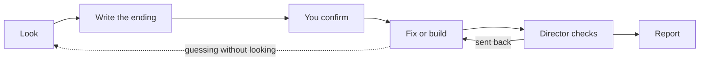

# rehearse

**A Claude Code plugin that makes the AI look at the real thing before it changes code, and won't let it call the work done until an independent check passes.**

Use it to fix a program that errors or gives a wrong result, or to build a small program that talks to the outside world, such as a scraper, an API client, an automation or a file converter.

## Why

Coding agents guess. They read some code, edit it, rerun the program and edit again, instead of looking at the thing that holds the answer: the server's real response, or the actual data one file hands to the next. One direct look usually finds the cause at once.

rehearse makes that direct look the rule. The AI does the job by hand first, agrees with you on what the right result is, and only then changes code. A second AI that did not do the work checks it before it may finish.

## Quick start

Install it in Claude Code:

```
/plugin marketplace add woosikkim/rehearse
/plugin install rehearse@rehearse
```

Claude Code does not update plugins from third-party marketplaces on its own by default. To get a new version, run `claude plugin update rehearse@rehearse` in your shell, or turn on **Enable auto-update** for this marketplace under `/plugin` → **Marketplaces**. A session that is already running keeps the version it loaded until you restart it or run `/reload-plugins`.

Start a prompt with the word `rehearse`. Add `fix` or `build` if you want to choose the mode yourself:

```
rehearse fix: the March total in the monthly report is wrong
rehearse build: a script that saves every product name and price from https://example.com/shop to products.csv
```

You'll see `rehearse is on — type rehearse stop to stop`. You can end the run at any time by typing `rehearse stop`, or by choosing **stop here and write the report** when you are asked a question.

Demo projects are in [`demos/`](demos/), each with its own README.

**Needs:** Claude Code, Python 3 and `curl`.

## How it works



1. **Look.** The AI does the job by hand against the real thing. It runs your program, calls your functions one step at a time in a *stage* (a Python session where the plugin logs every step), and gets real server responses with the plugin's `fetch` command. Code edits are locked while it looks.
2. **Write the ending.** The *ending* is the command to run and the result it must show. Every expected value has to come from something the AI saw or from your own words. The ending must fail right now, either because it shows the bug or because the program does not exist yet.
3. **You confirm.** You get one plain sentence with the command and values underneath. Your yes unlocks the code.
4. **Fix or build.** The AI changes the code and reruns the ending. If it keeps editing and rerunning without looking (two failed rounds by default), edits lock again until it takes a direct look.
5. **The director checks.** The *director* is a separate AI that did not do the work and cannot edit files. It reruns the ending and tries inputs the AI did not use. It compares the tests with how they stood before the change, and looks for shortcuts such as edited or skipped tests. Then it passes the work or sends it back, up to three times.
6. **Report.** The first line is `fixed` (every expected value verified), `built, not verified against the real target`, or `not fixed`. Below it are the ending table, what changed and what could not be verified.

The plugin enforces two locks. There are no code edits before you confirm the ending, and no finishing before the director passes the work or the AI writes an honest `not fixed` report. While it is looking, the AI also cannot run a file it has just written; it uses the plugin's own tools instead. Everything else is a reminder.

## Settings

| Setting | Default | What it does |
|---|---|---|
| `confirm_ending` | `true` | Ask you to confirm the ending. Turn it off for unattended runs; the director reviews the ending instead. |
| `max_rejections` | `3` | How many times the director may send the work back before the run ends with a `not fixed` report. |
| `loop_breaker_rounds` | `2` | Failed edit rounds without a direct look before edits lock again. |
| `director_model` | `opus` | The model the director runs on. |

Change them in your Claude Code settings file, for example:

```json
"pluginConfigs": {
  "rehearse@rehearse": { "options": { "confirm_ending": false } }
}
```

Each one can also be set with an environment variable: `REHEARSE_CONFIRM_ENDING`, `REHEARSE_MAX_REJECTIONS`, `REHEARSE_LOOP_BREAKER_ROUNDS`, `REHEARSE_DIRECTOR_MODEL`.

## Limits

- **Claude Code only.** claude.ai and Cowork do not install plugins that ship a `bin/` folder.
- **The stage is Python only.** In other languages the AI looks through `fetch`, your existing programs and your tests. If none of those can reach the problem, the loop breaker only reminds instead of locking, and the report says so.
- **The stage replays.** Each new step reruns the earlier ones in a fresh process, so a step that sends or changes data on a server would repeat. The AI is told to make such requests once with `fetch`, and the stage warns when a step opens a network connection.
- **Some things cannot be verified in one run.** This covers anything that needs time, credentials you have not given, or an irreversible action. The report lists these as not verified.
- **A run costs more than a plain request.** The director is a second AI, on Opus by default.
- **It never changes your files on its own.** If code changed while edits were locked, it names the files and asks for them to be put back.
- **No report means not fixed.** A run can end without a report: when you press Esc, when Claude Code hits a login or usage error, or when Claude Code stops holding the agent back. Treat any run without a report as not fixed.

<details>
<summary><b>Design notes: how this came to be</b></summary>

### The problem

I kept watching coding agents work on programs that talk to a server. They would change the code, rerun it and change it again. When an agent finally looked at the server's actual response, the fix took one step. I wanted that direct look to be the rule, not luck.

The second idea came from the same place. A program is often a chain of files. The agent can stand in for the failing file: take its real input, do its job by hand, hand the result to the next file, and see where the chain really breaks.

### Version 0.7: rules that checked activity

The first versions grew one rule at a time. Whenever an agent found a shortcut, I added a wall that refused it. I ran 132 practice runs on public coding-benchmark tasks, and over those runs the guard refused 451 of 3,361 tool calls:

- 281 refusals were about how a command was written.
- 157 were about the guard's own marker file.
- 13 came from the edit gate, the rule that actually mattered.

The two walls that stopped the agent from finishing fired 23 times. The code changed afterwards only twice. A trivial command such as `python3 --version` counted as running the program. Every blocked shortcut produced a new one, and the guard grew to almost 900 lines.

Three lessons:

- A rule that checks activity is satisfied by the least activity. A rule that checks the outcome can only be satisfied by doing the work.
- A rule that exists only in words gets ignored. If the right path is not the easiest one, agents route around it.
- "Not fixed, here is what we learned" is an acceptable outcome. "Fixed" when it is not is the worst one.

### Version 2: check outcomes

- **Two locks instead of many walls.** No edits until an ending is confirmed, and no finishing until an independent director passes the work.
- **The ending must fail first.** An ending that already passes proves nothing.
- **Make the right path the easiest.** The stage keeps the direct look cheap, so the agent no longer retypes its setup into one-off scripts. `fetch` saves real responses as evidence.
- **Defend against the easy path, not against forgery.** Agents take the shortest route that seems to satisfy a rule, but they do not forge records; none of the practice runs tried to. So there are no hashes or tokens, only checks on what agents actually do.
- **A complexity rule.** A mechanism goes in only if it serves a stated requirement or blocks an observed shortcut. Everything else waits on a list, along with the evidence that would bring it in.

### Trade-offs

- **A stage that replays steps instead of keeping a live process.** A live process needs sockets and background processes, which sandboxed shells refuse. A second transport would mean two behaviours to test. Replay is one mechanism. Its cost, repeated side effects, is handled with `fetch` and a network warning. A live process comes back if a real run shows harm.
- **State outside the project, with a copy inside.** Agents delete `.rehearsal/` as cleanup, so the real state lives in the plugin's data folder. The copy in the project is for the sandboxed command, and deleting it changes no decision.
- **Direct reruns count as failed rounds.** The plugin cannot judge an arbitrary command's output, so only its own run can count as a pass. That makes the plugin's run the easiest way out of a lock.

### How it is tested, and what that shows

- Deterministic tests of every rule, with no AI involved (`tests/`).
- Five eval cases on small demo projects, three runs each, with and without the plugin (`evals/`). All five pass at 2.0.0.
- Demos run by hand outside the eval sandbox, including the mock server whose documentation is wrong. In that run the director rejected the agent's first ending. That ending only checked the exit code, so a hard-coded script would have passed it.

This shows that the plugin behaves as designed on small cases. It is not a performance claim. The practice runs are kept on the [`practice-runs`](https://github.com/woosikkim/rehearse/tree/practice-runs) branch: 176 in all, with plugin versions and models mixed, of which the 132 above are the ones counted. They were used to find failure modes, and the guard was tuned on those same tasks. A proper measurement on tasks never used in development is planned.

### How it was built

I set the goals, made the design decisions and reviewed each revision. Claude Code, with oh-my-claudecode, wrote the code. The design went through ten plan revisions, with outside reviews, before any code was written. The design brief is in [`docs/rehearse-v2-brief.md`](docs/rehearse-v2-brief.md).

</details>

<details>
<summary><b>For developers</b></summary>

### Hooks

All of them run [`hooks/rehearse_hook.py`](hooks/rehearse_hook.py), which uses the Python 3 standard library only. State lives outside the project, in the plugin's data folder. Each save also writes a copy to `.rehearsal/<run id>/state.json` for the plugin's own command. The readable evidence (log, fixtures, report) lives in `.rehearsal/<run id>/`.

| Hook | What it does |
|---|---|
| `UserPromptSubmit` | Starts a run on `/rehearse` or a prompt that starts with the word `rehearse`, and injects the fix or build instructions. `rehearse stop` cancels the run. While the ending waits for confirmation, the next prompt is the answer. |
| `PreToolUse` | Until the ending is confirmed, refuses Write, Edit, MultiEdit and NotebookEdit on project code, and shell commands that write a code file. Refuses running a file created during the run. On a `rehearse:director` spawn, sets its prompt and model and keeps it in the foreground. Refuses edits by the director. |
| `PostToolUse` | Logs every command and its output to `log.md` and `commands.jsonl`. Reads the result line of each `rehearse` command into the state. Counts edit rounds and direct looks, and locks edits again after two failing rounds with no direct look. Records the answer to the confirmation question. |
| `SubagentStop` | Records the director's verdict, or its review of the ending in an unattended run. A verdict is void if code changed while the director worked. |
| `Stop` | Refuses to finish until the next step is done: register an ending, confirm it, spawn the director, or write `report.md` with an allowed first line. |

### Plugin commands

These are on the agent's path while the plugin is enabled ([`bin/rehearse`](bin/rehearse)):

```
rehearse ending --cmd '<cmd>' [--tests '<cmd>'] --expect '<requirement>' <check> <value> --cite <source> ...
rehearse run
rehearse fetch <url> [curl args]
rehearse status
rehearse stage start [--python <path>] | step '<code>' | stop
```

### Tests

```
python3 tests/run_all.py
claude plugin eval . --scaffold --allow-tools Bash Write Edit Agent --trust-plugin --runs 3
```

The first command runs the deterministic hook, stage and director tests, and prints nothing on success. The second runs the five cases in `evals/`, with and without the plugin.

### More limits

- Inside other interpreters (node, ruby and so on), nothing checks what a one-line program does; only the files it writes are seen afterwards.
- Files written outside the project are recorded, not refused.
- An ending whose command is a bare name or an unresolved module (`make check`, `python3 -m pkg`) closes an edit round only through `rehearse run`.
- In an unattended run the director's review of the ending stops after two rounds; what it still found uncovered is listed in the report.
- A loop inside one command runs to the end before any check sees it.
- Claude Code stops honouring a Stop hook after eight blocks in a row with no tool call in between (Claude Code 2.1.300, probe P7). An agent that only keeps trying to finish can therefore end without a report. Interrupts and authentication errors skip the Stop hook by design.
- If you edit project code yourself while edits are locked, the ending cannot be registered until those files are restored.
- Taking a fingerprint of the project is slow on Windows folders mounted under WSL, about 1 to 2 seconds per check.

</details>

## License

MIT
